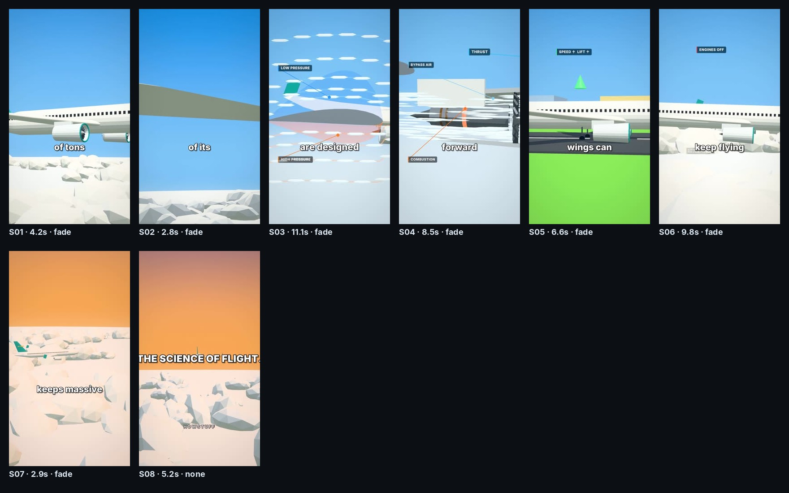
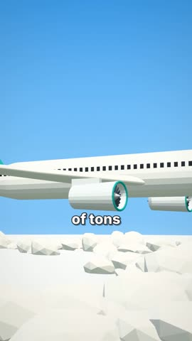
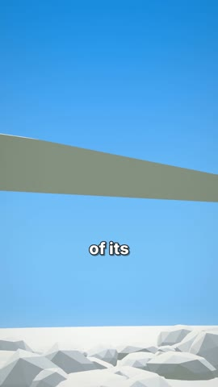
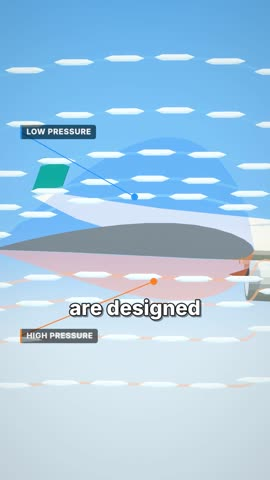
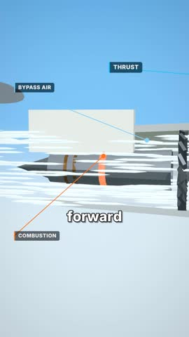
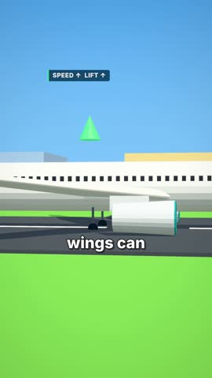
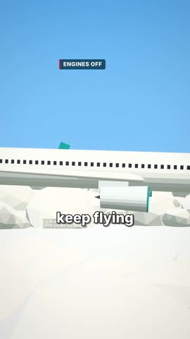
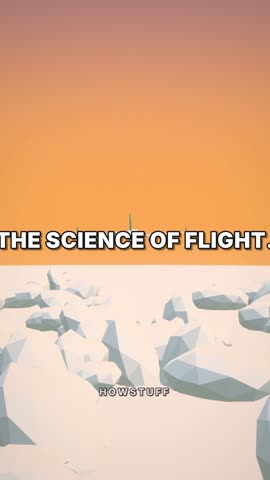

# Storyboard — How Can a 300-Ton Airplane Stay in the Air?

Duração total: 51.1s · 8 cenas

## S01 — 0.0s → 4.2s (4.2s)

**Narração:** How can a machine weighing hundreds of tons stay in the air?

**Visual:** HOOK. A big twin-engine airliner cruises high above a sea of clouds in dramatic sunlight; the camera sweeps around it from below the nose.

**Câmera:** aerial sweep from front-low to side

**Efeitos sonoros:** impact @ 0.0s, wind @ 0.0s, motor_hum @ 0.4s

**Transição:** fade

## S02 — 4.2s → 7.0s (2.8s)

**Narração:** The answer lies in the shape of its wings.

**Visual:** Close-up behind the wing root looking out along the wing; white airflow streaks race over and under the wing surface.

**Câmera:** close tracking over the wing

**Efeitos sonoros:** wind @ 0.0s

**Transição:** fade

## S03 — 7.0s → 18.1s (11.1s)

**Narração:** As an airplane moves forward, air flows around its wings, creating aerodynamic forces. The wings are designed to generate lift, helping the aircraft overcome gravity.

**Visual:** A section plane slices the wing, revealing its curved airfoil profile. Streamlines flow around it: rising ahead of the leading edge, faster over the top (low pressure, blue), slower below (high pressure, orange), turned downward behind the trailing edge. A big LIFT arrow grows upward against a WEIGHT arrow.

**Câmera:** move into the wing section, hold on the airfoil

**Efeitos sonoros:** cut_reveal @ 0.2s, wind @ 1.1s, ui_tick @ 5.0s, ui_tick @ 6.7s, riser @ 8.3s

**Transição:** fade

## S04 — 18.1s → 26.6s (8.5s)

**Narração:** But there's another important factor, the engines. They push the airplane forward, allowing air to continuously flow around the wings.

**Visual:** Close-up of a turbofan cut in half: big fan, compressor stages, glowing combustor, turbine. Bypass air (blue) and hot core flow (orange) stream out; a THRUST arrow points forward while air keeps flowing over the wing.

**Câmera:** orbit the engine section, then pull back to wing + engine

**Efeitos sonoros:** motor_hum @ 0.0s, wind @ 0.4s, ui_tick @ 4.2s

**Transição:** fade

## S05 — 26.6s → 33.2s (6.6s)

**Narração:** The faster the airplane moves, the more lift its wings can generate, within operating limits.

**Visual:** On the runway the airliner accelerates; a speed bar and the LIFT arrow grow together; at rotation the nose lifts and the plane takes off, gear retracting.

**Câmera:** side tracking shot along the runway, then chase as it climbs

**Efeitos sonoros:** rumble @ 0.0s, motor_hum @ 0.0s, riser @ 3.6s

**Transição:** fade

## S06 — 33.2s → 43.0s (9.8s)

**Narração:** And here's something incredible. An airplane doesn't actually need its engines to keep flying. If the engines stop, it can still glide through the air.

**Visual:** High above the clouds the engines go quiet (fans only windmilling, no exhaust). The plane keeps flying on a gentle glide path; label: about 15 meters forward for every meter down.

**Câmera:** smooth side tracking, slight descent

**Efeitos sonoros:** clunk @ 2.5s, wind @ 2.9s, ui_tick @ 5.9s

**Transição:** fade

## S07 — 43.0s → 46.0s (2.9s)

**Narração:** That's the science that keeps massive aircraft flying

**Visual:** Wide golden-hour shot: the airliner small above an endless sea of clouds, warm sunlight.

**Câmera:** slow wide pan

**Efeitos sonoros:** shimmer @ 0.0s

**Transição:** fade

## S08 — 46.0s → 51.1s (5.2s)

**Narração:** thousands of meters above the ground.

**Visual:** Close behind the aircraft as it flies away into the golden horizon. Final title THE SCIENCE OF FLIGHT. with small HOWSTUFF branding.

**Câmera:** follow from behind, the plane pulls away toward the sun

**Efeitos sonoros:** wind @ 0.0s, outro @ 1.6s

**Transição:** none
