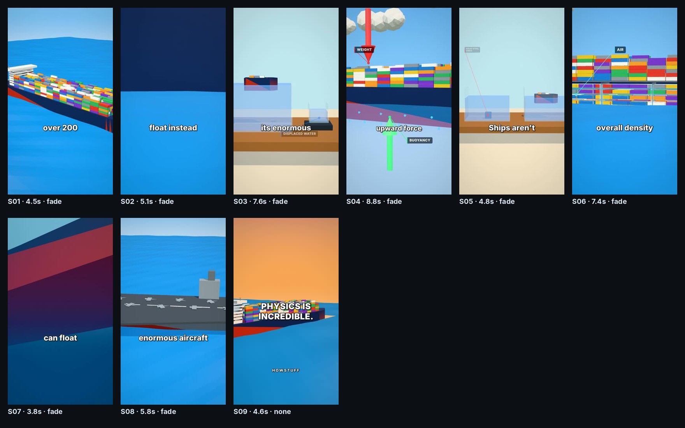
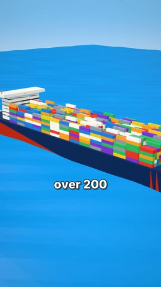
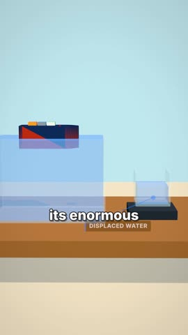
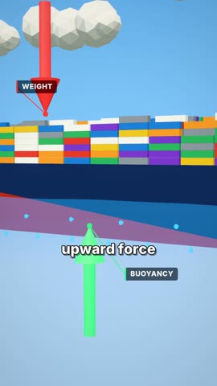
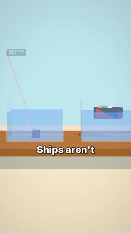
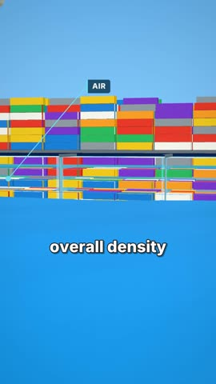
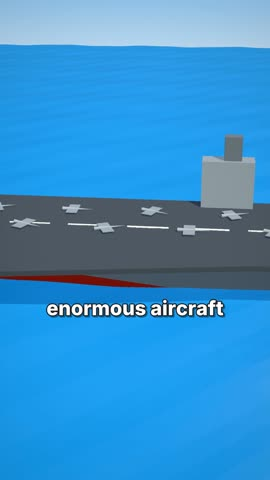

# Storyboard — How Does a 200,000-Ton Steel Ship Float?

Duração total: 52.4s · 9 cenas

## S01 — 0.0s → 4.5s (4.5s)

**Narração:** A massive cargo ship can weigh over 200,000 tons,

**Visual:** HOOK. Dramatic aerial shot of an enormous container ship stacked with colorful containers, cutting through the ocean with a white wake.

**Câmera:** aerial descending orbit

**Efeitos sonoros:** impact @ 0.0s, ocean @ 0.0s

**Transição:** fade

## S02 — 4.5s → 9.6s (5.1s)

**Narração:** so how does something made mostly of steel float instead of sinking?

**Visual:** The camera glides down to the waterline along the giant steel hull, then dips below the surface to reveal the red underwater hull.

**Câmera:** descend to the waterline and dip under

**Efeitos sonoros:** ocean @ 0.0s, underwater @ 3.1s

**Transição:** fade

## S03 — 9.6s → 17.1s (7.6s)

**Narração:** The secret is displacement. When a ship enters the water, its enormous hull pushes water out of the way.

**Visual:** Classic Archimedes demo: Nova lowers a steel model ship into a full glass tank; the water level rises and spills into a beaker on a scale - the displaced water.

**Câmera:** side view of the tank, push toward the overflow

**Efeitos sonoros:** underwater @ 1.5s, ocean @ 3.4s, ui_tick @ 5.7s

**Transição:** fade

## S04 — 17.1s → 26.0s (8.8s)

**Narração:** That displaced water creates an upward force called buoyancy. As long as this upward force balances the ship's weight, it floats.

**Visual:** Back to the real ship, sea made see-through: water pressure arrows push on the submerged hull; a big BUOYANCY arrow grows until it equals the WEIGHT arrow; the ship settles and floats.

**Câmera:** low 3/4 view at the waterline

**Efeitos sonoros:** ui_tick @ 0.9s, riser @ 3.5s, clunk @ 6.2s

**Transição:** fade

## S05 — 26.0s → 30.8s (4.8s)

**Narração:** But here's the interesting part. Ships aren't solid blocks of steel.

**Visual:** Two glass tanks: a solid steel block plunges to the bottom; the same amount of steel shaped as a hollow hull floats.

**Câmera:** frontal view of both tanks

**Efeitos sonoros:** impact @ 1.0s, underwater @ 1.2s, ui_tick @ 2.9s

**Transição:** fade

## S06 — 30.8s → 38.1s (7.4s)

**Narração:** Their hollow hulls contain enormous amounts of air, making their overall density much lower than solid steel.

**Visual:** Cutaway of the container ship: double bottom, bulkheads, cargo holds with containers, engine room - and the large air-filled spaces glowing light blue. Label: average density lower than water.

**Câmera:** orbit into the longitudinal section

**Efeitos sonoros:** cut_reveal @ 0.1s, shimmer @ 2.9s, ui_tick @ 4.8s

**Transição:** fade

## S07 — 38.1s → 42.0s (3.8s)

**Narração:** That's why even the biggest ships can float across the ocean.

**Visual:** Underwater view: the huge red hull and propeller pass overhead in deep blue water with bubbles.

**Câmera:** underwater looking up

**Efeitos sonoros:** underwater @ 0.0s

**Transição:** fade

## S08 — 42.0s → 47.8s (5.8s)

**Narração:** And the same principle allows tiny objects and enormous aircraft carriers to stay afloat.

**Visual:** A gigantic aircraft carrier floats on the ocean; aerial cinematic orbit over the flight deck.

**Câmera:** aerial orbit

**Efeitos sonoros:** ocean @ 0.0s, wind @ 1.2s

**Transição:** fade

## S09 — 47.8s → 52.4s (4.6s)

**Narração:** It's all about physics.

**Visual:** Wide shot of the cargo ship sailing into a golden sunset. Final title PHYSICS IS INCREDIBLE. with small HOWSTUFF branding.

**Câmera:** slow wide pull-back

**Efeitos sonoros:** ocean @ 0.0s, outro @ 0.9s

**Transição:** none
