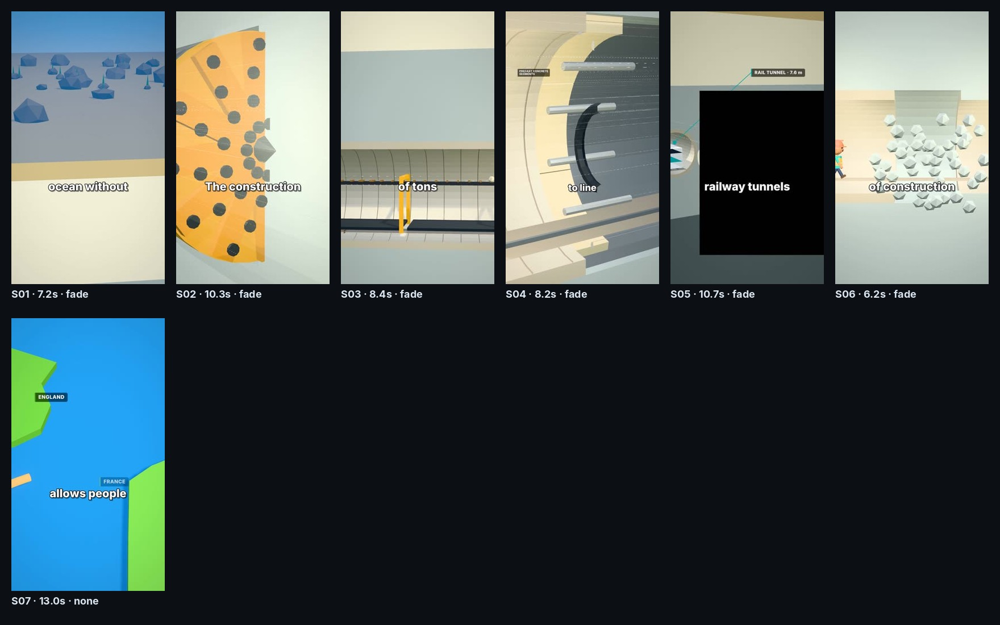
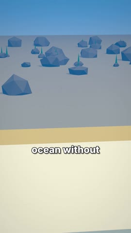
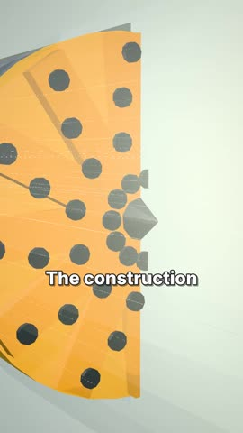
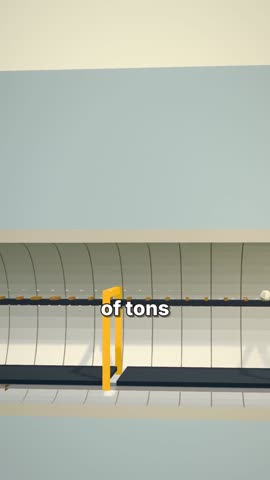
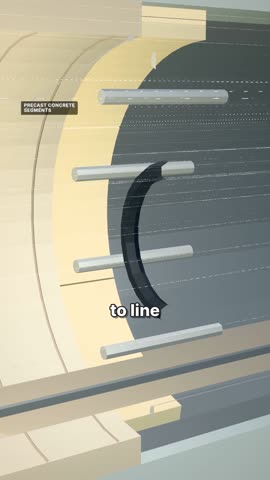
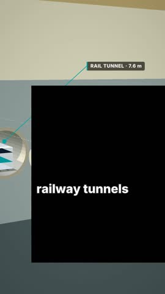
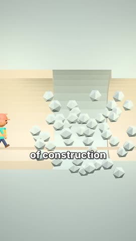
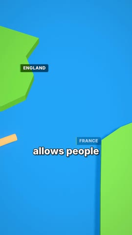

# Storyboard — How Did They Build a Tunnel Under the Ocean?

Duração total: 64.0s · 7 cenas

## S01 — 0.0s → 7.2s (7.2s)

**Narração:** Imagine building a tunnel dozens of kilometers long beneath the ocean, without letting the water flood the construction site.

**Visual:** HOOK. Aerial over the English Channel between white chalk cliffs; the camera skims the low-poly waves and dives under the surface (blue underwater tint), down to the seabed; a section plane slices the ground revealing geological layers and the tunnels running far below the seabed.

**Câmera:** aerial skim, dive through the water surface, descend to the geological section

**Efeitos sonoros:** impact @ 0.0s, ocean @ 0.0s, underwater @ 2.7s, cut_reveal @ 5.1s

**Transição:** fade

## S02 — 7.2s → 17.5s (10.3s)

**Narração:** It sounds impossible. But that's exactly what engineers accomplished between England and France. The construction relied on enormous machines called tunnel boring machines.

**Visual:** Wide front view of a giant tunnel boring machine in the chalk marl (rock ahead shown translucent): rotating cutterhead with disc cutters, shield, hydraulic thrust rams. Otto at the controls on the back-up gantry gives scale. Move closer to the cutterhead biting into the chalk.

**Câmera:** front tracking shot, then close-up of the rotating cutterhead

**Efeitos sonoros:** rumble @ 0.0s, hydraulic @ 5.7s

**Transição:** fade

## S03 — 17.5s → 26.0s (8.4s)

**Narração:** They slowly moved through the seabed, cutting through layers of rock and removing thousands of tons of material. But digging was only part of the challenge.

**Visual:** Side section tracking shot: the TBM advances; chalk spoil falls from the cutterhead onto the conveyor and travels back to muck wagons on rails; new tunnel appears behind the machine. Pull back to show the geological layers and the sea far above.

**Câmera:** side tracking along the machine, then pull back to show the sea above

**Efeitos sonoros:** rumble @ 0.0s, conveyor @ 0.8s

**Transição:** fade

## S04 — 26.0s → 34.2s (8.2s)

**Narração:** As the machines advanced, they installed massive precast concrete segments to line the tunnel walls and keep the structure protected.

**Visual:** Inside the rear of the shield: the hydraulic erector arm picks a curved precast concrete segment, swings it around and places it to complete a ring; the key segment closes the ring. Pull back to reveal the finished rings receding down the tunnel while the TBM keeps advancing.

**Câmera:** close mechanical shot of the erector, then wide tunnel reveal

**Efeitos sonoros:** hydraulic @ 0.4s, clunk @ 3.0s, hydraulic @ 4.1s, clunk @ 5.4s

**Transição:** fade

## S05 — 34.2s → 44.9s (10.7s)

**Narração:** And here's something even more surprising. They didn't build just one tunnel. The project consists of two main railway tunnels and a third service tunnel, used for maintenance and emergency access.

**Visual:** Side view of the tunnel, then the section plane rotates to a cross-section revealing THREE parallel tunnels: two 7.6 m rail tunnels (a passenger train in one, a vehicle shuttle carrying cars and trucks in the other) and the smaller 4.8 m service tunnel in the middle with a service vehicle; cross-passages connect them. Labels with dimensions.

**Câmera:** orbit from side view to full cross-section

**Efeitos sonoros:** whoosh_in @ 0.2s, ui_tick @ 3.7s, ui_tick @ 5.3s, ui_tick @ 7.1s, train_pass @ 4.3s

**Transição:** fade

## S06 — 44.9s → 51.0s (6.2s)

**Narração:** All three run beneath the seabed. After years of construction, the teams finally connected both sides.

**Visual:** Wide section: tunnels running under the seabed from both coasts. Two crews approach from the English and French sides; the last rock wall crumbles and Otto shakes hands with the French crew through the opening. Label DECEMBER 1990.

**Câmera:** wide underground shot, slow push toward the breakthrough

**Efeitos sonoros:** rumble @ 0.6s, rock_break @ 2.8s, riser @ 3.7s

**Transição:** fade

## S07 — 51.0s → 64.0s (13.0s)

**Narração:** The result was one of the most impressive engineering projects in history: the Channel Tunnel. A railway passage that allows people and vehicles to cross between England and France without taking a boat.

**Visual:** A passenger train races toward camera through the lit tunnel; side tracking shot; then a map of England and France with the tunnel line from Folkestone to Calais beneath the Channel; final wide pull-back of the three tunnels under the sea.

**Câmera:** front tracking, side tracking, geographic pull-back

**Efeitos sonoros:** train_pass @ 0.0s, whoosh_in @ 6.5s, impact @ 10.6s

**Transição:** none
