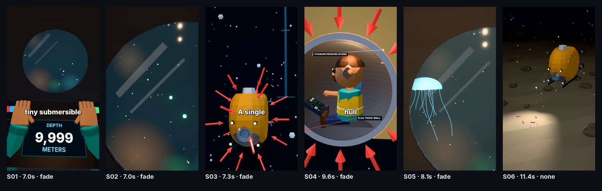
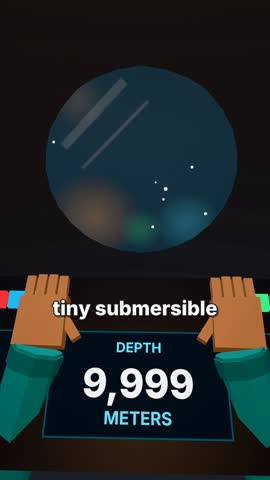
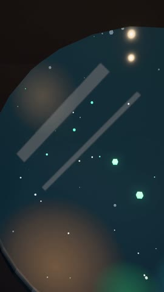
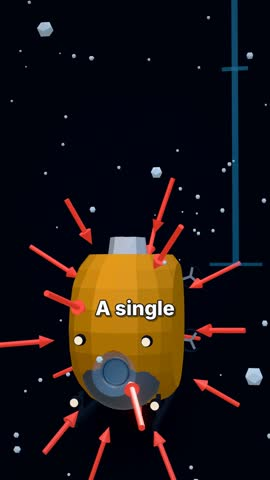
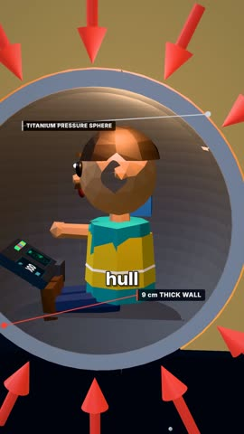
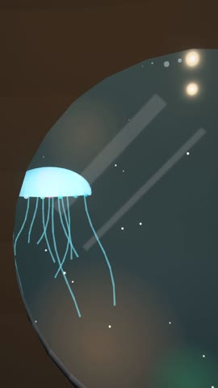
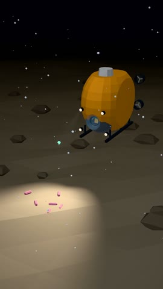

# Storyboard — You Are 10,000 Meters Under the Ocean

Duração total: 50.4s · 6 cenas

## S01 — 0.0s → 7.0s (7.0s)

**Narração:** You're now 10,000 meters beneath the ocean. You're sitting inside a tiny submersible.

**Visual:** HOOK. First-person inside the sphere: hands at the glowing control panel, depth readout ticking to 10,000 m, circular front window, the water outside darkening, marine snow rising past.

**Câmera:** first-person, slow forward drift, subtle vibration

**Efeitos sonoros:** impact @ 0.0s, underwater @ 0.0s, motor_hum @ 0.4s, ui_tick @ 2.1s, ui_tick @ 4.9s

**Transição:** fade

## S02 — 7.0s → 14.0s (7.0s)

**Narração:** Outside your window, there's complete darkness.

**Visual:** Close to the thick conical acrylic window: endless black water, tiny bioluminescent specks blinking, warm cabin lights reflected on the glass.

**Câmera:** approach the window, look slightly left and right

**Efeitos sonoros:** underwater @ 0.0s, shimmer @ 2.1s, shimmer @ 4.9s

**Transição:** fade

## S03 — 14.0s → 21.3s (7.3s)

**Narração:** The pressure surrounding you is over a thousand times greater than at the surface. A single structural failure could be catastrophic.

**Visual:** Exterior: the small submersible inside an enormous dark water column. Pressure arrows squeeze it from every side; a depth gauge rises to the far-away surface: 0 m, sunlight ends ~1,000 m, you at 10,000 m.

**Câmera:** slow orbit, pull back and tilt up the column

**Efeitos sonoros:** rumble @ 0.0s, ui_tick @ 1.5s, riser @ 3.6s, clunk @ 6.2s

**Transição:** fade

## S04 — 21.3s → 30.9s (9.6s)

**Narração:** But somehow, you're still alive. Your submarine is protected by a specially engineered pressure-resistant hull. Its thick walls keep the crushing ocean pressure outside.

**Visual:** Exterior into a cutaway: the foam body and the titanium sphere are sectioned to show the 9 cm wall and the pilot inside with cabin lights; pressure arrows stop at the hull.

**Câmera:** exterior, cutaway, then slow rotation around the hull

**Efeitos sonoros:** cut_reveal @ 0.5s, ui_tick @ 2.9s, ui_tick @ 5.3s, hydraulic @ 6.7s

**Transição:** fade

## S05 — 30.9s → 39.0s (8.1s)

**Narração:** And as you look into the darkness, you realize something terrifying.

**Visual:** First-person: a translucent glowing jellyfish drifts past the window; far away, a mysterious lure-light of a deep-sea fish bobs in the dark.

**Câmera:** first-person, follow the creature

**Efeitos sonoros:** underwater @ 0.0s, shimmer @ 1.2s, riser @ 4.4s

**Transição:** fade

## S06 — 39.0s → 50.4s (11.4s)

**Narração:** You're exploring a world where sunlight has never reached.

**Visual:** The tiny submersible's lamps light a small patch of the trench floor; the camera pulls back until it is a speck of light in endless darkness; title; fade to black.

**Câmera:** slow pull-back

**Efeitos sonoros:** underwater @ 0.0s, rumble @ 1.1s, outro @ 7.0s

**Transição:** none
