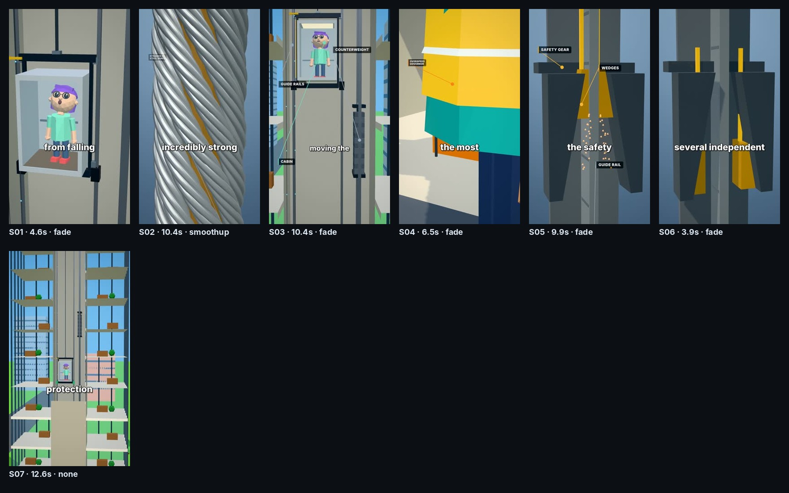
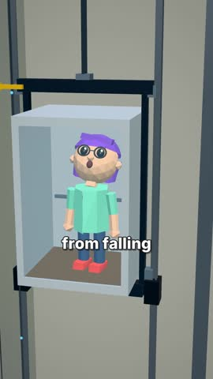
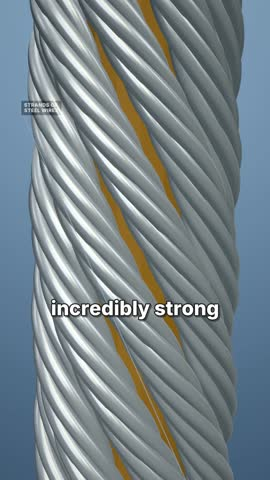
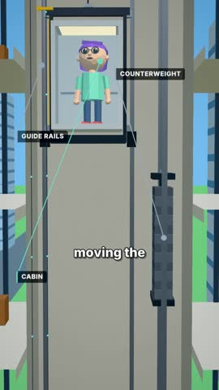
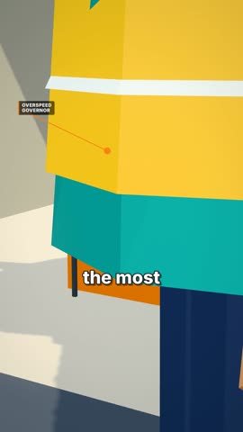
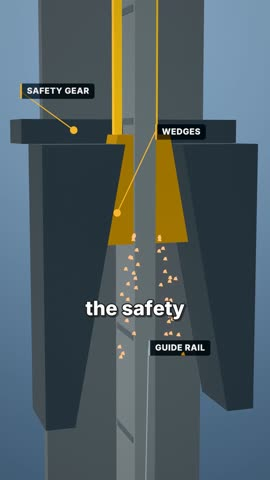
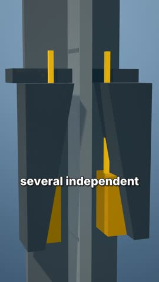
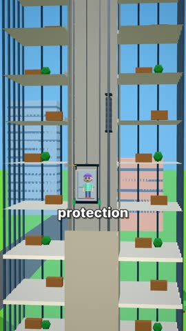

# Storyboard — What Actually Stops an Elevator From Falling?

Duração total: 58.4s · 7 cenas

## S01 — 0.0s → 4.6s (4.6s)

**Narração:** Have you ever wondered what stops an elevator from falling dozens of floors?

**Visual:** HOOK. Aerial shot of a low-poly glass skyscraper in a sunny city. Fast push-in; the facade slices away (section plane) as the camera passes through the wall, revealing the vertical shaft. The cabin travels downward with Nova inside looking up. Vertigo feeling.

**Câmera:** fast aerial push-in, pass through the facade, vertical tracking of the cabin

**Efeitos sonoros:** impact @ 0.0s, wind @ 0.1s, cut_reveal @ 2.1s, motor_hum @ 2.5s

**Transição:** fade

## S02 — 4.6s → 15.0s (10.4s)

**Narração:** The answer is more fascinating than you might think. First, elevators use incredibly strong steel suspension cables designed to carry enormous loads.

**Visual:** Medium shot of the cabin hanging in the shaft from 4 steel ropes. Camera climbs along the ropes; macro reveal of one rope: outer strands twisted around a core, each strand made of individual wires; the end of the rope opens into a cross-section. A load arrow shows the rope carrying the cabin.

**Câmera:** slow climb along ropes, macro zoom into the rope cutaway

**Efeitos sonoros:** rope_creak @ 0.5s, shimmer @ 4.4s, rope_creak @ 7.3s

**Transição:** smoothup

## S03 — 15.0s → 25.5s (10.4s)

**Narração:** But they don't work alone. At the top of the building, an electric motor turns a massive pulley, moving the cables while a counterweight balances much of the elevator's weight.

**Visual:** Wide cutaway of the whole traction system: machine room with motor, brake and traction sheave, deflector sheave, ropes, cabin, counterweight and guide rails. Otto stands by the machine and points. The cabin goes up while the counterweight goes down, then reverses; the sheave turns accordingly. Labels name each part.

**Câmera:** orbit around the machine room, then wide side cutaway of the full shaft

**Efeitos sonoros:** motor_hum @ 0.0s, ui_tick @ 3.1s, ui_tick @ 5.7s, clunk @ 6.5s

**Transição:** fade

## S04 — 25.5s → 32.0s (6.5s)

**Narração:** But what happens if something goes wrong? That's where one of the most impressive safety systems comes in.

**Visual:** The cabin runs normally. Cut to the overspeed governor next to the machine: its sheave turns with the governor rope loop that runs down the shaft to a tension pulley in the pit and is tied to the cabin; the flyweights spin. Otto watches it closely. Slow tension-building push-in.

**Câmera:** slow macro push toward the governor

**Efeitos sonoros:** governor_spin @ 0.0s, riser @ 3.2s

**Transição:** fade

## S05 — 32.0s → 41.9s (9.9s)

**Narração:** If the elevator moves too fast, a special mechanism called an overspeed governor activates the safety gear, gripping the guide rails and slowing the cabin down.

**Visual:** Wide: the cabin accelerates downward (machine brake failure). Speed gauge rises. Governor flyweights fly out and the jaw clamps the governor rope; the rope stops while the cabin continues, pulling the safety linkage. Close-up section of the safety gear: wedges slide up the tapered housing and squeeze the guide rail; the cabin decelerates progressively and stops. Nova grabs the handrail, then relaxes.

**Câmera:** wide shaft, then extreme close-up of the safety gear cutaway

**Efeitos sonoros:** wind @ 0.0s, governor_trip @ 2.8s, wedge_grip @ 4.6s, clunk @ 7.9s

**Transição:** fade

## S06 — 41.9s → 45.8s (3.9s)

**Narração:** There are also motor brakes and several independent safety systems.

**Visual:** Fast technical tour of the cutaway: 1) machine brake shoes clamp the drum, 2) traction machine, 3) overspeed governor, 4) safety gear, 5) spring buffers in the pit. Each highlights with a soft glow and a label, synchronized with a tick.

**Câmera:** smooth descending move through the system, one beat per component

**Efeitos sonoros:** clunk @ 0.1s, ui_tick @ 0.9s, ui_tick @ 1.6s, ui_tick @ 2.4s, buffer @ 3.2s

**Transição:** fade

## S07 — 45.8s → 58.4s (12.6s)

**Narração:** So a modern elevator doesn't rely on just one cable to keep you safe. It's designed with multiple layers of protection. And that's exactly why elevator accidents are so rare.

**Visual:** Close-up of the cabin gliding up smoothly, Nova smiling and waving. Pull back: the full shaft with its safety layers glowing one by one, then the section closes and the camera flies back out to a beautiful wide shot of the skyscraper in the sunny city. Ding at the end.

**Câmera:** long continuous pull-back from cabin to architectural wide shot

**Efeitos sonoros:** motor_hum @ 0.6s, riser @ 6.9s, elevator_ding @ 11.3s

**Transição:** none
