# Storyboard — Como funciona uma fechadura com chave

Duração total: 58.3s · 12 cenas

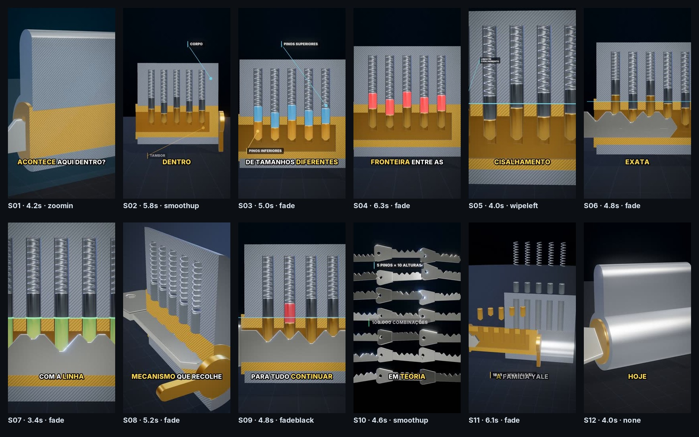

## S01 — 0.0s → 4.2s (4.2s)

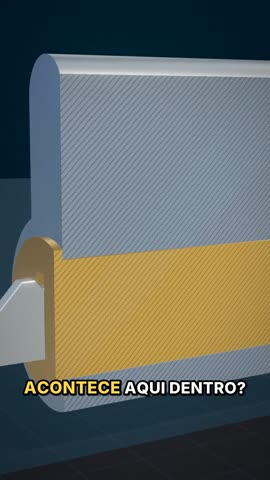

**Narração:** Você gira uma chave todo dia. Mas o que acontece aqui dentro?

**Visual:** GANCHO. Close cinematográfico da fechadura inteira em aço; a chave desliza para dentro do tambor. No meio da cena, um plano de corte luminoso atravessa a fechadura e remove a metade da frente, revelando os pinos subindo e descendo enquanto a chave entra.

**Câmera:** 3/4 frontal baixo, dolly-in lento com leve arco para a direita

**Efeitos sonoros:** whoosh_in @ 0.0s, key_slide @ 0.5s, cut_reveal @ 2.0s, pin_clicks @ 2.6s

**Transição:** zoomin

## S02 — 4.2s → 10.0s (5.8s)

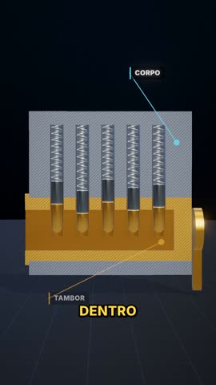

**Narração:** Esta é uma fechadura de pinos. Por fora, o corpo. Dentro, um cilindro que gira: o tambor.

**Visual:** Vista em corte, sem chave. A câmera gira suavemente para a vista frontal do corte. Etiqueta CORPO aponta para a carcaça de aço; depois TAMBOR aponta para o cilindro de latão, que pulsa levemente.

**Câmera:** orbit de 35° até vista frontal do corte

**Efeitos sonoros:** ui_tick @ 1.7s, ui_tick @ 3.6s

**Transição:** smoothup

## S03 — 10.0s → 15.1s (5.0s)

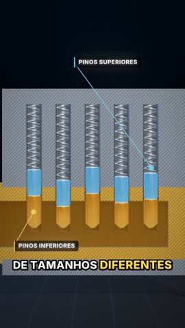

**Narração:** Atravessando os dois, colunas de pinos de tamanhos diferentes, empurrados por molas.

**Visual:** A câmera sobe pela torre de pinos. Os pinos inferiores (latão) acendem em sequência, depois os superiores (aço), depois as molas comprimem e esticam levemente. Etiquetas PINOS INFERIORES, PINOS SUPERIORES e MOLAS.

**Câmera:** tilt up ao longo da torre

**Efeitos sonoros:** ui_tick @ 0.8s, ui_tick @ 2.3s, spring @ 3.6s

**Transição:** fade

## S04 — 15.1s → 21.4s (6.3s)

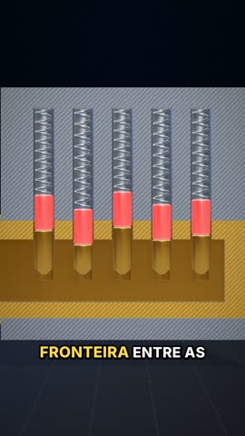

**Narração:** Sem a chave, as molas empurram os pinos para baixo. Eles cruzam a fronteira entre as peças, e o tambor não gira.

**Visual:** As molas empurram as colunas para baixo. Os pinos superiores que atravessam a fronteira ficam vermelhos. O tambor tenta girar, avança um grau e trava, com tremor. A alavanca traseira (came) mal se mexe.

**Câmera:** vista frontal do corte, push-in para a fronteira

**Efeitos sonoros:** spring @ 0.8s, blocked @ 3.9s, blocked @ 4.9s

**Transição:** fade

## S05 — 21.4s → 25.4s (4.0s)

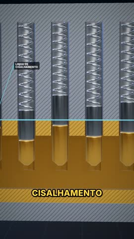

**Narração:** Essa fronteira é a linha de cisalhamento. Tudo depende dela.

**Visual:** Uma linha ciano luminosa se desenha da esquerda para a direita exatamente na fronteira entre o tambor e o corpo. Etiqueta LINHA DE CISALHAMENTO. Câmera trava lateralmente ao longo da linha.

**Câmera:** travelling lateral rente à linha

**Efeitos sonoros:** laser_draw @ 0.2s, ui_tick @ 1.6s

**Transição:** wipeleft

## S06 — 25.4s → 30.2s (4.8s)

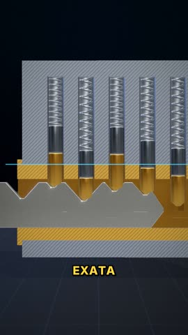

**Narração:** A chave certa empurra cada pino até uma altura exata.

**Visual:** CENA PRINCIPAL. A chave entra pela esquerda; cada dente levanta e solta os pinos conforme passa (cinemática real do perfil da chave). Ao final, cada pino inferior está apoiado no seu corte.

**Câmera:** vista frontal do corte, leve dolly acompanhando a chave

**Efeitos sonoros:** key_slide @ 0.2s, pin_clicks @ 0.6s, key_seat @ 3.8s

**Transição:** fade

## S07 — 30.2s → 33.6s (3.4s)

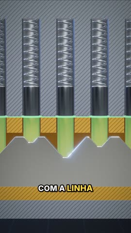

**Narração:** E todas as divisões se alinham com a linha.

**Visual:** Close na linha de cisalhamento: as cinco divisões entre os pinos acendem em verde, uma a uma, exatamente sobre a linha.

**Câmera:** push-in macro na linha

**Efeitos sonoros:** align_chime @ 0.5s

**Transição:** fade

## S08 — 33.6s → 38.8s (5.2s)

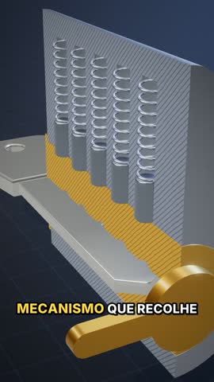

**Narração:** Nada mais bloqueia. O tambor gira e aciona o mecanismo que recolhe a lingueta.

**Visual:** O tambor gira 90° levando a chave e os pinos inferiores; os superiores ficam no corpo. A câmera orbita para trás mostrando a alavanca (came) girando, que é o que move a lingueta da porta.

**Câmera:** orbit de frontal para 3/4 traseira

**Efeitos sonoros:** turn @ 0.9s, clunk @ 2.9s

**Transição:** fade

## S09 — 38.8s → 43.6s (4.8s)

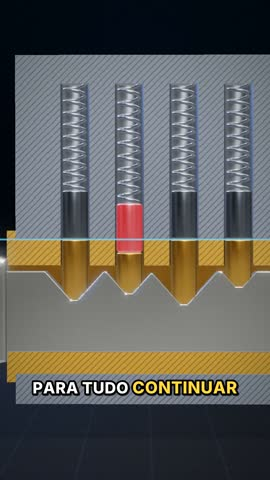

**Narração:** Com a chave errada, basta um pino fora do lugar para tudo continuar travado.

**Visual:** Vista em corte com uma chave diferente (segundo corte mais fundo). Ao inserir, o segundo pino fica baixo demais; seu pino superior cruza a linha e fica vermelho. O tambor tenta girar e trava.

**Câmera:** frontal do corte, push-in no pino errado

**Efeitos sonoros:** key_slide @ 0.2s, pin_clicks @ 0.5s, blocked @ 3.4s, error @ 3.9s

**Transição:** fadeblack

## S10 — 43.6s → 48.2s (4.6s)

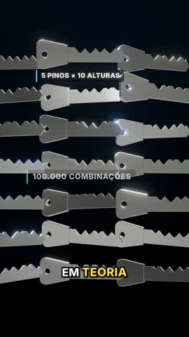

**Narração:** Cinco pinos, até dez alturas cada: em teoria, cem mil combinações.

**Visual:** Dezenas de chaves com cortes diferentes surgem em uma grade 3D que se expande enquanto a câmera recua. Etiquetas 5 PINOS × 10 ALTURAS e 100.000.

**Câmera:** pull-back amplo

**Efeitos sonoros:** swarm @ 0.2s, impact @ 3.2s

**Transição:** smoothup

## S11 — 48.2s → 54.3s (6.1s)

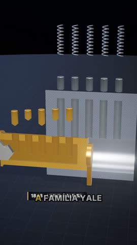

**Narração:** A ideia tem milhares de anos, mas a versão moderna surgiu com a família Yale, no século dezenove.

**Visual:** Vista explodida: todas as peças da fechadura se separam no ar e giram lentamente, como em um catálogo técnico. Etiqueta 1848 · LINUS YALE SR.

**Câmera:** orbit lento 360° parcial

**Efeitos sonoros:** explode @ 0.3s, ui_tick @ 3.4s

**Transição:** fade

## S12 — 54.3s → 58.3s (4.0s)

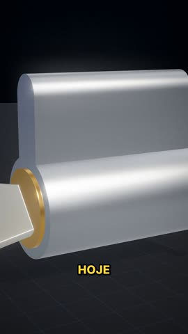

**Narração:** E provavelmente é ela que tranca a sua porta hoje.

**Visual:** As peças se remontam em um movimento único; a chave entra e gira. Plano heroico final com a fechadura inteira e fade para preto.

**Câmera:** pull-back para plano heroico

**Efeitos sonoros:** assemble @ 0.0s, turn @ 2.2s, clunk @ 2.9s, outro @ 3.4s

**Transição:** none
