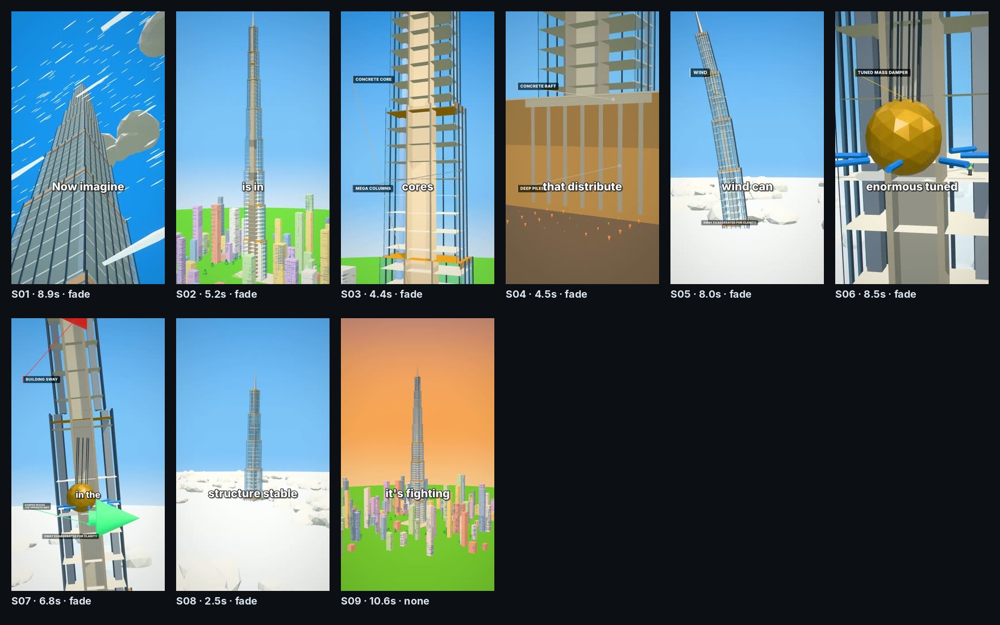
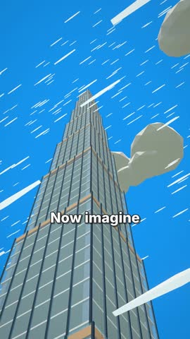
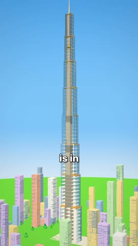
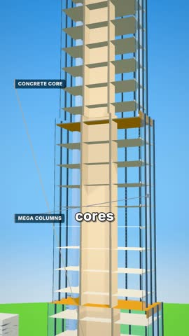
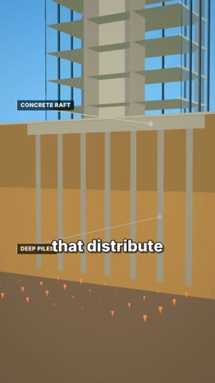
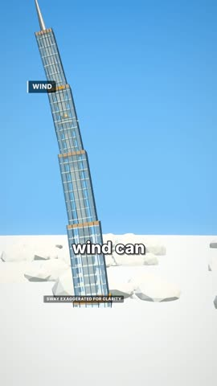
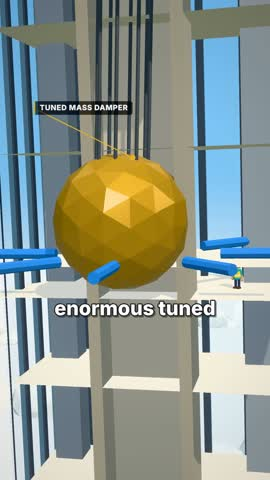
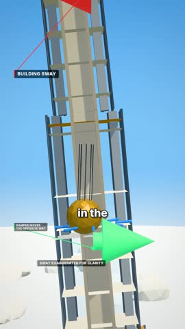
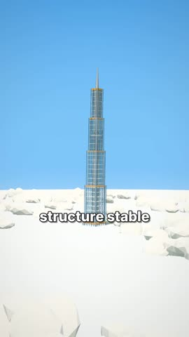
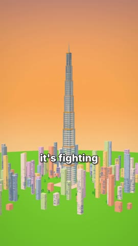

# Storyboard — Why Don't 800-Meter Skyscrapers Fall Over?

Duração total: 59.5s · 9 cenas

## S01 — 0.0s → 8.9s (8.9s)

**Narração:** Imagine standing inside a building that's over 800 meters tall. Now imagine powerful winds pushing against it.

**Visual:** HOOK. Street level: Nova looks up; the camera tilts dramatically up the supertall tower into the clouds while wind streaks rush through the city.

**Câmera:** low street-level tilt and crane up the facade

**Efeitos sonoros:** impact @ 0.0s, wind @ 0.0s, riser @ 4.5s

**Transição:** fade

## S02 — 8.9s → 14.2s (5.2s)

**Narração:** So why doesn't it fall over? The secret is in its engineering.

**Visual:** A section plane slices the tower top to bottom, revealing the structure inside the glass skin.

**Câmera:** wide 3/4, section sweep

**Efeitos sonoros:** cut_reveal @ 0.5s

**Transição:** fade

## S03 — 14.2s → 18.5s (4.4s)

**Narração:** Skyscrapers are built with massive structural cores, reinforced columns,

**Visual:** Labels: concrete CORE (glowing), perimeter MEGA COLUMNS and OUTRIGGER belts tying them together; floor slabs stacked.

**Câmera:** move along the section from mid-height upward

**Efeitos sonoros:** ui_tick @ 0.9s, ui_tick @ 2.4s

**Transição:** fade

## S04 — 18.5s → 23.1s (4.5s)

**Narração:** and carefully designed foundations that distribute their enormous weight.

**Visual:** Underground section: thick reinforced concrete raft and a grid of deep piles in the soil layers; load arrows spread down into the ground.

**Câmera:** dive below street level into the foundation section

**Efeitos sonoros:** rumble @ 0.0s, ui_tick @ 2.3s

**Transição:** fade

## S05 — 23.1s → 31.1s (8.0s)

**Narração:** But there's another challenge, wind. At extreme heights, wind can push buildings from side to side.

**Visual:** Strong wind visualized as flowing particle streaks curling into vortices behind the tower; the tower flexes gently side to side without breaking (sway exaggerated for clarity).

**Câmera:** wide tracking around the upper tower

**Efeitos sonoros:** wind @ 0.0s, rope_creak @ 2.4s, rope_creak @ 5.6s

**Transição:** fade

## S06 — 31.1s → 39.6s (8.5s)

**Narração:** Engineers use special structural systems, flexible materials, and sometimes enormous tuned mass dampers to reduce dangerous movement.

**Visual:** The section opens near the top: inside the upper floors a gigantic golden spherical mass hangs from steel cables, with hydraulic dampers around it; Otto on the observation deck for scale.

**Câmera:** fly into the upper floors, orbit the damper

**Efeitos sonoros:** cut_reveal @ 0.4s, hydraulic @ 3.4s, shimmer @ 6.0s

**Transição:** fade

## S07 — 39.6s → 46.4s (6.8s)

**Narração:** Some buildings even contain giant weights near their upper floors that move in the opposite direction to the building's sway.

**Visual:** Engineering view of the tower top: building sway arrow one way, damper arrow the other way, in rhythm; the damper's swing counteracts the motion and the sway shrinks.

**Câmera:** side view of the upper tower section

**Efeitos sonoros:** hydraulic @ 0.7s, hydraulic @ 3.4s

**Transição:** fade

## S08 — 46.4s → 48.9s (2.5s)

**Narração:** This helps keep the structure stable.

**Visual:** Wide aerial: the tower stands tall above the clouds in strong wind.

**Câmera:** wide aerial

**Efeitos sonoros:** wind @ 0.0s

**Transição:** fade

## S09 — 48.9s → 59.5s (10.6s)

**Narração:** So the next time you look at a skyscraper, remember, it's not just standing against gravity, it's fighting the wind too.

**Visual:** The camera slowly pulls away into a breathtaking city skyline at golden hour. Final title ENGINEERING DEFIES THE IMPOSSIBLE. with small HOWSTUFF branding.

**Câmera:** long slow pull-back

**Efeitos sonoros:** wind @ 0.0s, outro @ 7.4s

**Transição:** none
