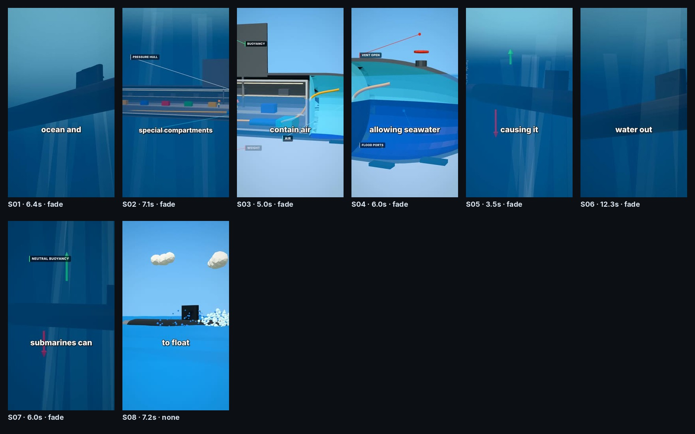
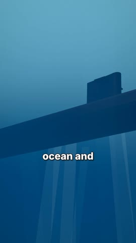
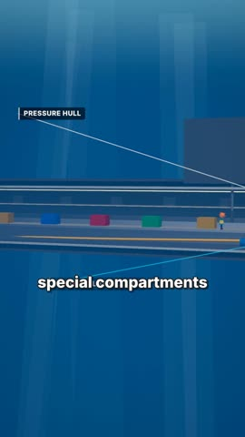
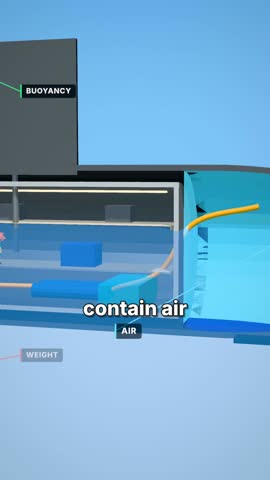
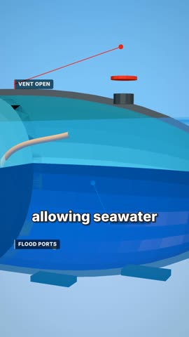
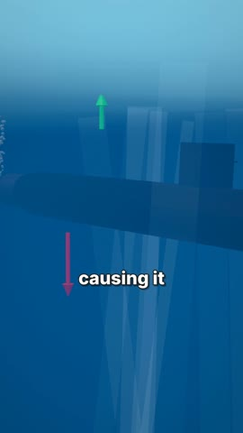
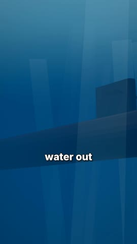
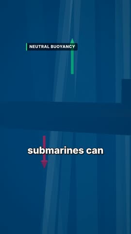
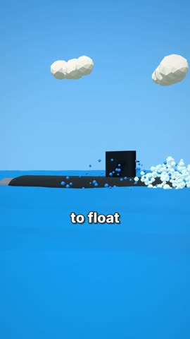

# Storyboard — How Does a Submarine Sink and Rise Again?

Duração total: 53.5s · 8 cenas

## S01 — 0.0s → 6.4s (6.4s)

**Narração:** How can a massive steel submarine sink deep into the ocean and then return to the surface?

**Visual:** HOOK. Underwater, looking up at the bright rippling surface with sun rays: a huge dark submarine slides down from the surface, bubbles streaming from its vents, disappearing into the deep blue.

**Câmera:** low underwater angle looking up, slow drift as the hull passes overhead

**Efeitos sonoros:** impact @ 0.0s, underwater @ 0.0s, riser @ 1.3s

**Transição:** fade

## S02 — 6.4s → 13.5s (7.1s)

**Narração:** The secret is hidden inside its walls. Submarines have special compartments called ballast tanks.

**Visual:** A section plane slices the submarine lengthwise: outer hull, pressure hull with decks and crew, and the main ballast tanks between the two hulls at bow and stern glow and get labeled.

**Câmera:** 3/4 orbit while the cutaway reveals the interior, then side view

**Efeitos sonoros:** cut_reveal @ 0.4s, ui_tick @ 3.9s, shimmer @ 5.0s

**Transição:** fade

## S03 — 13.5s → 18.6s (5.0s)

**Narração:** When the submarine is on the surface, these tanks contain air, helping it float.

**Visual:** Section view of the boat floating at the waterline; the ballast tanks are filled with bright transparent blue air. Buoyancy arrow (up) is bigger than weight arrow (down).

**Câmera:** side section at the waterline, slow push

**Efeitos sonoros:** ocean @ 0.0s, ui_tick @ 2.3s

**Transição:** fade

## S04 — 18.6s → 24.6s (6.0s)

**Narração:** But when it's time to dive, valves open, allowing seawater to enter while air escapes.

**Visual:** Close cutaway of the bow ballast tank: the vent valve on top opens and air jets out as spray; seawater rushes in through the flood ports at the bottom; the water level inside rises; the boat starts to settle lower.

**Câmera:** close cutaway of the tank, slight tilt following the rising water

**Efeitos sonoros:** clunk @ 0.3s, wind @ 0.7s, underwater @ 1.2s

**Transição:** fade

## S05 — 24.6s → 28.1s (3.5s)

**Narração:** This makes the submarine heavier, causing it to sink.

**Visual:** Wide underwater shot: the boat descends into darker blue water, bubbles trailing; weight arrow now bigger than buoyancy.

**Câmera:** dramatic descending follow shot

**Efeitos sonoros:** underwater @ 0.0s, rope_creak @ 0.3s

**Transição:** fade

## S06 — 28.1s → 40.3s (12.3s)

**Narração:** But here's the incredible part. To rise again, the submarine releases compressed air into the tanks, forcing the water out. Now it's lighter, and buoyancy pushes it back toward the surface.

**Visual:** Cutaway: vents closed; high-pressure air flows from the air flasks through pipes into the ballast tanks; the water is pushed out through the flood ports at the bottom and the air volume grows. Then a wide shot as the boat rises toward the bright surface with the buoyancy arrow growing.

**Câmera:** cutaway close-up, then wide rising shot

**Efeitos sonoros:** hydraulic @ 1.5s, wind @ 3.7s, riser @ 7.4s

**Transição:** fade

## S07 — 40.3s → 46.3s (6.0s)

**Narração:** And by carefully controlling the amount of water inside, submarines can even hover underwater.

**Visual:** The submarine hangs motionless in the deep, surrounded by darkness and shafts of blue light; equal buoyancy and weight arrows; small trim tanks pulse; label NEUTRAL BUOYANCY.

**Câmera:** slow cinematic orbit, wide

**Efeitos sonoros:** underwater @ 0.0s, shimmer @ 3.0s

**Transição:** fade

## S08 — 46.3s → 53.5s (7.2s)

**Narração:** It's basically a giant machine that controls its own ability to float.

**Visual:** Emergency-blow style surfacing: the bow bursts out of the ocean with water cascading off the hull, spray and sunlight, then the boat settles on the surface. Final title ENGINEERING IS INCREDIBLE. with small HOWSTUFF branding.

**Câmera:** low epic angle at the waterline, then pull back

**Efeitos sonoros:** riser @ 0.1s, impact @ 2.2s, ocean @ 2.3s, outro @ 4.8s

**Transição:** none
